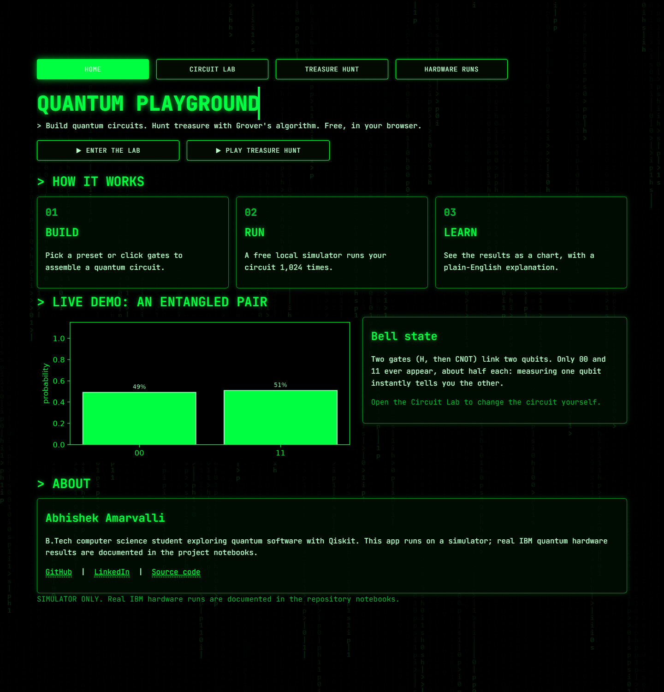
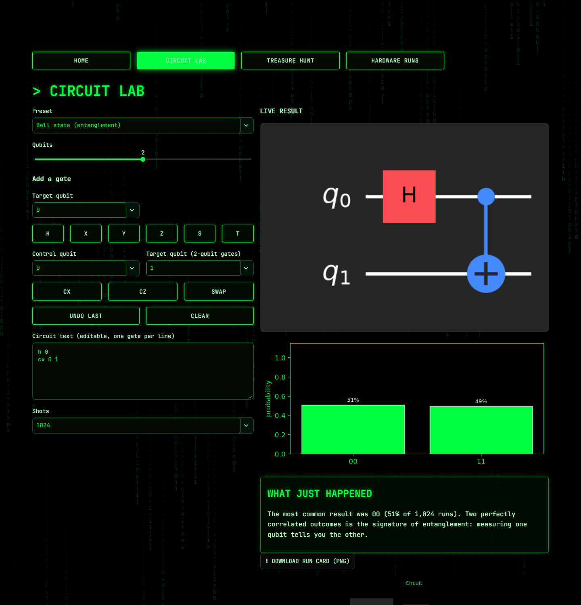
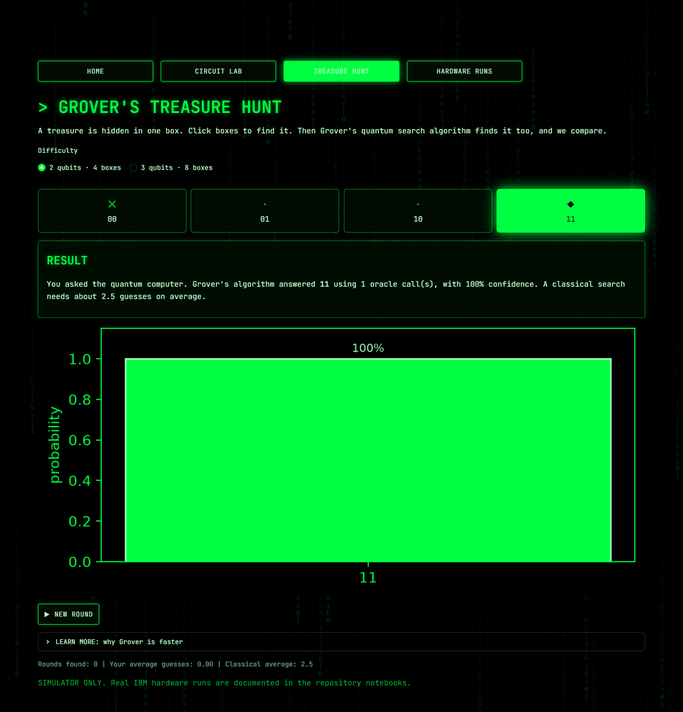
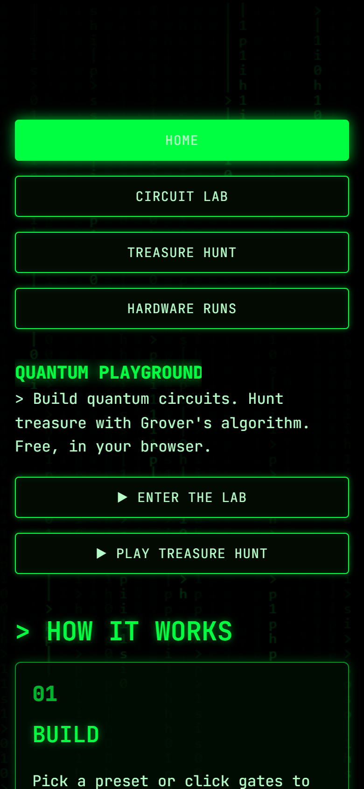
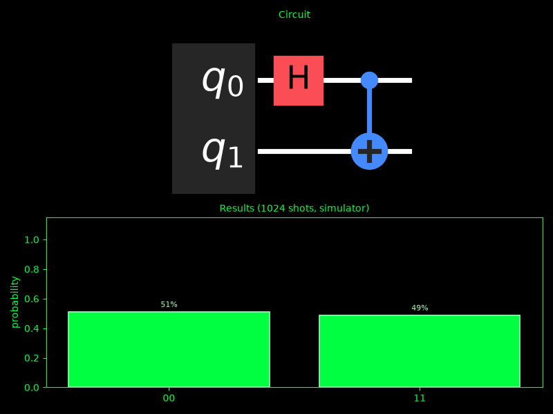

# ⚛️ Quantum Playground

> Build quantum circuits. Hunt treasure with Grover's algorithm. Free, in your browser.

A dark, Matrix-green Streamlit app for learning quantum computing by doing: assemble circuits with gate buttons or plain text, watch the simulator run them live, and play a treasure hunt against Grover's search algorithm.



## What's inside

| Page | What it does |
| --- | --- |
| **Home** | Hero, a 3-step "how it works", a live Bell-state demo, and links to the author. |
| **Circuit Lab** | Presets, one-click gates (H, X, Y, Z, S, T, CX, CZ, SWAP), undo/clear, an editable circuit text box, 1–3 qubits, 256/1024/4096 shots. Diagram, histogram and a plain-English "What just happened" update live. Downloadable PNG run card. |
| **Treasure Hunt** | A treasure hides in one of 4 (or 8) boxes. Click boxes to search classically, then let Grover's algorithm find it with 1 oracle call (2 for 8 boxes) and compare. Staggered reveal animation, histogram, and a "why Grover is faster" explainer. |
| **Hardware Runs** | Saved run cards and IBM dashboard screenshots from real hardware jobs, newest first. Images only — the app never contacts IBM. |

### Circuit Lab



### Grover's Treasure Hunt



### Phone layout



### Simulator run card (downloadable PNG)



## Run it locally

```bash
pip install -r requirements.txt
streamlit run app.py
```

Then open <http://localhost:8501>.

Requirements: Python 3.12+, `streamlit`, `qiskit`, `qiskit-aer`, `matplotlib`, `pylatexenc`.

## Project structure

```
app.py                      Streamlit UI only (pages, styling, callbacks)
qplay.py                    All quantum logic (build_from_text, run_sim,
                            grover_circuit, grover_iterations, render_snapshot)
.streamlit/config.toml      Dark neon theme
docs/screenshots/           README screenshots
docs/hardware_runs/         Saved run cards / dashboard images + JSON metadata
```

Every circuit is simulated locally with Qiskit Aer. Nothing is sent anywhere except the JetBrains Mono stylesheet request to Google Fonts.

## Notes

- Qiskit prints qubit 0 as the **rightmost** bit, so the box labelled `10` is qubit 0 in state 0 and qubit 1 in state 1.
- Keep circuits at 3 qubits or fewer: diagrams stay readable and results are instant.
- The app is simulator-only. Real IBM hardware runs were done separately in notebooks and are shown as saved images on the **Hardware Runs** page.

## Author

**Abhishek Amarvalli** — B.Tech computer science student exploring quantum software with Qiskit.

[GitHub](https://github.com/AbhishekAmarvalli) · [LinkedIn](https://www.linkedin.com/in/YOUR-HANDLE)
